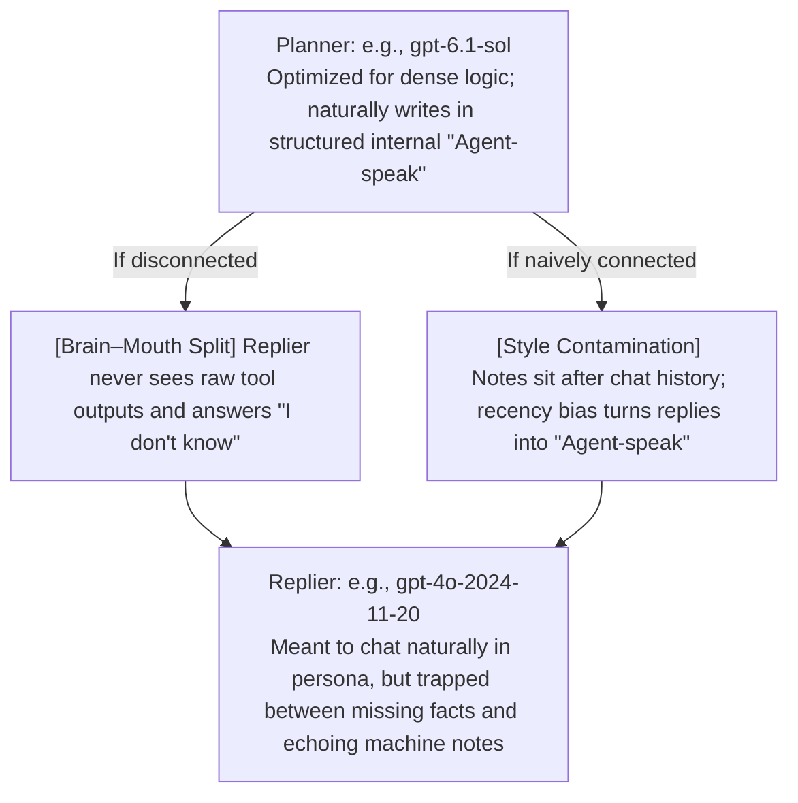

<p align="center">
  
</p>

# Reply Integrity

[简体中文](README.md)

**Give MaiBot's Replier the full facts—and strip away stiff "Agent-speak" so it can talk in its own natural voice.**

In a dual-agent setup (**Planner + Replier**—for example, pairing a reasoning-focused **`gpt-6.1-sol` Planner** with an expressive **`gpt-4o-2024-11-20` Replier**), reply quality frequently suffers from two cross-stage failure modes: **missing tool facts** and **background style contamination**.

Reply Integrity addresses both issues through official SDK hooks without touching MaiBot's core codebase:

- **Bridges the fact gap (fixes "brain–mouth split")**: Passes the conversational goal and recent tool observations directly to the Replier, complete with execution status, timestamps, and truncation markers.
- **Stops unidirectional style contamination (eliminates "Agent-speak" / *A言gent语*)**: Instructs the Planner to jot down concise bullet points rather than a ready-to-send script, and moves background notes ahead of chat history so **recency bias** doesn't pull the Replier into echoing stiff internal "Agent-speak."

The plugin requires **no extra model calls**, **no core source edits**, **no API keys**, and **no additional capability grants**. At runtime, it relies solely on the official MaiBot Plugin SDK and the Python standard library.

## Core Background: Why Persona Tuning Alone Isn't Enough

MaiBot separates **Planner (reasoning and tool execution)** from **Replier (persona and expression)**. Search results, reply references, chat history, and final outgoing text pass through distinct stages. When running capable model pairs like **`gpt-6.1-sol` (Planner) + `gpt-4o-2024-11-20` (Replier)**, problems that look like a poorly tuned persona typically stem from two underlying pipeline mechanisms:

### The Planner → Replier Dilemma: Disconnected Facts vs. "Agent-Speak" Contamination



- **Brain–mouth split (missing facts between stages)**: MaiBot's standard reply path strips raw tool outputs from chat history. If the Planner's `reply_reference` omits a key detail or status, the Replier has to answer in the dark. Tweaking `Personality` or `Reply style` cannot restore facts that never reached the Replier.
- **Unidirectional style contamination ("Agent-speak" / *A言gent语*)**: Reasoning-heavy Planners naturally formulate thoughts in compressed, bureaucratic machine prose (e.g., *"Based on current findings, advise the user that…"*). Because the Host appends that reference **after** chat history, right before generation, **recency bias** causes the Replier to lazily mirror the Planner's syntax and tone—turning a casual conversation into stiff "Agent-speak."

> **Troubleshooting Note:** **Seeing *"I don't know"* in chat does not by itself pinpoint the cause**—it could be honest uncertainty from the model or missing context between stages. Always cross-check tool outputs, raw generated text, and final delivery logs.

## Scenarios: Before & After

*Note: The examples below are fictional illustrations, not raw chat logs. The "Without the plugin" column shows potential pipeline failure modes, while "With Reply Integrity" shows the intended conversational behavior rather than fixed templates or guaranteed model outputs.*

### Scenario 1: Search found the facts, but chat sounds like "Agent-speak"

| Stage | Without the plugin | With Reply Integrity |
| :--- | :--- | :--- |
| **User question** | *"Did you find the project's update?"* | *"Did you find the project's update?"* |
| **Planner reference** | *"Based on current findings, inform the user that version 2.4 has been released and direct them to the release notes."* (Appended **after** chat history, triggering recency bias) | Tool schema requests brief notes only, e.g., `Version: v2.4`, `Goal: share update`, `Link: https://example.org/releases/v2.4` (Moved **before** chat history) |
| **Tool context** | Raw tool outputs are excluded from the Replier's chat history; the Replier relies entirely on the Planner's summary. | Up to 4 recent non-`reply` tool outputs from the active Planner context are injected before chat history, preserving status and truncation flags. |
| **Illustrative reply** | *"The project has currently released version 2.4; you may consult the release notes for further details."* (Classic "Agent-speak") | *"Found it! It's on v2.4 now. Here's what changed: https://example.org/releases/v2.4"* |

**How it helps:** Updating the tool parameter description nudges the Planner to write concise points, though prompts cannot deterministically prevent every full-sentence draft. Even when the Planner still writes a polished paragraph of "Agent-speak," the plugin moves it ahead of chat history and instructs the Replier to extract only the facts and intent while speaking in its own voice.

### Scenario 2: A search is running (or finished), but the Replier cannot see its status

Asynchronous MCP searches require distinguishing between a request that is still running and one that has already returned:

| Actual state | Potential failure without the plugin | With Reply Integrity |
| :--- | :--- | :--- |
| **Tool returns `pending`** (the Planner knows the request is still running) | The reference omits the pending state, so the Replier has no idea a search is in progress and simply replies *"I don't know."* | Passes both the `pending` status and the waiting intent to the Replier, prompting an honest update: *"Still waiting on the results—give it a moment."* |
| **Tool completed** (returned a version number and release link) | The Planner reference says only "announce the update," omitting the version and link. | Injects the version and link from the tool output so the Replier can answer from the actual result. |

**How it helps:** The plugin passes through actual tool status and results. It does not speed up external tools themselves; `pending` tasks still require a subsequent check.

## Installation & Upgrades

### Requirements

- **MaiBot**: `1.3.19`
- **maibot-plugin-sdk**: `2.20.0`
- **Context Item Schema**: `v1`

*Verified on MaiBot `1.3.19` with SDK `2.20.0`. Other versions within the supported range must preserve the hook contracts described below.*

### Setup Steps

1. Copy this directory into your MaiBot instance at `plugins/reply_integrity/`.
2. Load or reload **Reply Integrity** in the plugin manager (plugin ID: `github.zerlight.reply-integrity`).
3. Check the logs for `Reply Integrity 1.3.0 hooks active`.

### Recommended: Disable Host Response Post-Processing

Turn off the global response post-processing switch in MaiBot WebUI, or set the following in the Host's `bot_config.toml`:

```toml
[response_post_process]
enable_response_post_process = false
```

In MaiBot `1.3.19`, this switch returns generated text directly, skipping splitting, typo injection, bracket cleanup, and overflow fallbacks. Disabling only the splitter is not equivalent. This is a Host setting; the plugin does not change it. Long replies still remain subject to the chat platform's per-message length limit.

### Upgrading & Uninstalling

- **Upgrading from 1.2.0 or earlier**: The old ID is `local.reply-integrity`; version 1.2.1 uses `github.zerlight.reply-integrity`. Stop MaiBot, back up and preserve the existing `config.toml`, overwrite the same `plugins/reply_integrity/` directory, then start MaiBot and check the new ID's enabled state. The Host treats the new ID as a different plugin; do not load both copies, which would process replies twice.
- **Upgrading to 1.3.0**: Configuration migration removes the old `bypass_post_processing` field and preserves other settings. Response post-processing now follows Host configuration entirely; if you previously relied on the plugin bypass, turn off the Host's global switch as described above.
- **Disabling or unloading**: Stops prompt injection for subsequent requests and clears cached tool results without changing Host configuration.

## Settings

Select **Reply Integrity** in MaiBot WebUI's plugin configuration page. The SDK generates the form and applies saved changes without restarting MaiBot.

| Setting in `[plugin]` | Default | Behavior |
| :--- | :--- | :--- |
| `inject_tool_facts` | `true` | Toggle capture and injection of recent tool results visible to the current Planner request. |
| `separate_reply_style` | `true` | Toggle Planner parameter guidance, reference placement and conversational cues. |
| `max_results` | `4` | Recent tool result count, **1–16**, excluding `reply` receipts. |
| `max_result_chars` | `12000` | Characters per result, **1–48,000**; longer results are truncated and marked. |

The two feature switches are independent. `enabled` controls the whole plugin, and the SDK manages `config_version`. Settings are stored in the plugin directory's `config.toml`. Updating plugin settings clears cached results; the next Planner request captures them with the new limits. Higher limits increase prompt size, token usage and memory use.

The mechanisms and examples below describe the default settings.

## How It Works

### 1. Hook Pipeline

| Public Hook | Stage & Responsibility |
| :--- | :--- |
| `maisaka.planner.before_request` | Captures up to 4 recent non-`reply` tool outputs from the active context and rewrites the `reply_reference` parameter description on the `reply` tool to ask for concise bullet points and core facts. |
| `maisaka.replyer.before_request` | Stashes the original reference and reason in an internal per-call field and swaps in a one-time marker so the Host does not append the raw draft after chat history (preserving retry idempotency). |
| `maisaka.replyer.before_model_request` | Strips the temporary marker, inserts the `<planner_instruction_and_facts>` block after system rules and before chat history, and appends a brief conversational cue at the end of normal chat requests. |

### 2. Context Layout Comparison (Neutralizing Recency Bias)

For normal chat requests, the context sequence sent to the Replier model changes as follows (simplified to omit optional expression-style blocks):

```text
[Host Default] Persona & system rules → Chat history → Planner reference (triggers recency bias) → Current reply requirements
[With Plugin]  Persona & system rules → Planner notes & tool facts → Chat history → Current reply requirements → Brief conversational cue
```

By default, the Host places the Planner reference *after* chat history. Moving background notes and tool facts *before* chat history keeps the tail end of the prompt anchored in the actual conversation and the user's latest message—reducing the tendency to echo "Agent-speak" (though context ordering is a soft nudge rather than a hard guarantee).

### 3. Scope & Safety Boundaries

- **Chat vs. document generation**: Chat history content, roles, and relative ordering remain untouched. Conversational rephrasing rules apply only to standard `maisaka.replyer` chat requests (`request_type == "maisaka.replyer"`), leaving plugin-API document generation unaffected. Even in casual chat, explicit requests for formal writing, verbatim quotes, code blocks, names, numbers, and URLs are preserved accurately.
- **Untrusted tool output isolation**: Tool observations are treated strictly as untrusted data. Embedded `<` characters inside the JSON payload are escaped as `\u003c` within `<planner_instruction_and_facts>`, and the system policy explicitly forbids following instructions found inside tool outputs.
- **No word blacklists**: The plugin strips away "Agent-speak" through context placement and prompt policy rather than deleting specific words via regex or vocabulary blacklists.

## Caching & Limitations

- **In-memory session cache**: Tool observations are cached in memory per `session_id` (capped at **64 sessions**, **4 observations per session**, and **12,000 characters per observation**, with an explicit `"truncated": true` flag when clipped). Each Planner request refreshes that session's cache, and unloading the plugin clears all cached entries.
- **Context visibility window**: Only recent tool outputs present in the Planner's current context are captured. Newly produced outputs enter the cache on the next Planner request, so a result produced in the same tool batch may not reach the current `reply`. If the Host has already condensed a result, the plugin receives that condensed content. The `truncated` flag describes only the plugin's own character truncation; clipped details are not available to the Replier.
- **Zero extra disk logging**: The plugin writes no persistent logs of its own; Host prompt traces, reasoning logs, and chat history continue to follow your Host retention settings.
- **Prompt-level constraints**: Tool schema descriptions and system prompts guide model behavior but cannot mathematically guarantee bullet-point formatting or a specific speaking style on every turn.
- **Hook execution order**: If other installed plugins modify the same prompt items or reply kwargs, the final behavior depends on hook execution order.
- **Contract compatibility**: Future changes to Host hook signatures or Context Item schema versions will require plugin updates. Because the Host skips failing hook handlers by default, check your logs after upgrading MaiBot.

## Verification & Tests

Run the standalone unit test suite (7 tests covering SDK settings validation and configuration migration, hot reload, independent switches, tool schema rewriting, prompt ordering & retry idempotency, session cache eviction & truncation bounds, invalid payload rejection, and non-chat style isolation):

```sh
uv run --group dev pytest -q tests/test_plugin.py
```

In an isolated MaiBot source environment with full Host dependencies installed, you can also run the 1 Host integration test (which exercises the real prompt builder and Context Item deserializer):

```sh
python -m pytest -q tests
```

*All tests use synthetic fixtures and never invoke external models or send live messages.*

## Changelog

### 1.3.0

- Removed the response post-processing hook and switch; replies now follow Host settings. Added setup guidance for disabling the Host's global response post-processing switch.
- Updated the configuration version to 1.3.0, removing the old field while preserving other settings during migration.

### 1.2.1

- Changed the plugin ID to `github.zerlight.reply-integrity` and documented installation and migration from the old ID. Functionality and the configuration format are unchanged.

### 1.2.0

- Added SDK settings for three feature switches and tool result count/character limits, preserving existing defaults.
- Clear cached results on configuration updates and preserve references in requests being assembled when style separation changes.
- Added a plugin icon, bilingual Mermaid diagrams and settings documentation.

### 1.1.0

- Decoupled Planner "Agent-speak" from Replier voice via `reply_reference` schema updates, style isolation policies, and a trailing conversational cue.
- Eliminated the Host's duplicate trailing reference block while preserving retry state and custom hook kwargs.
- Added bilingual documentation in Simplified Chinese and English.

## License

[MIT](LICENSE)
