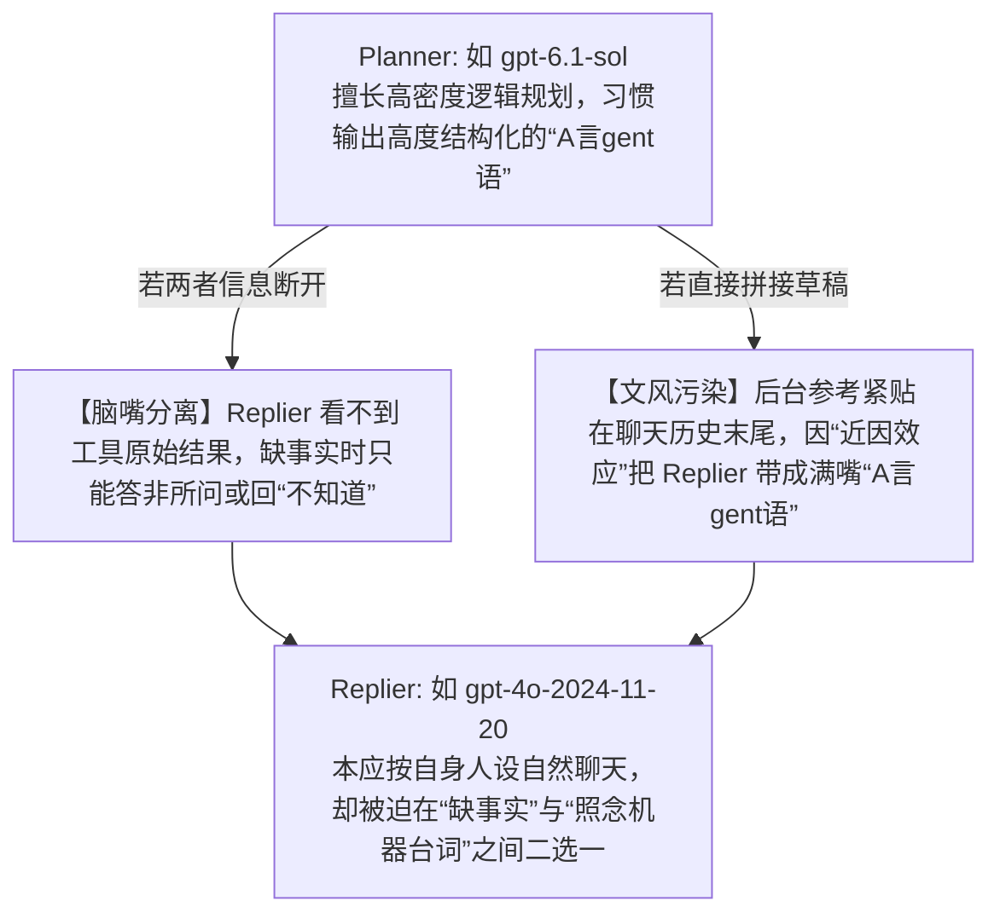

<p align="center">
  
</p>

# Reply Integrity

[English](README.en.md)

**让 MaiBot 的回复器拿到完整事实，同时摆脱“A言gent语”，用自己的口吻自然说话。**

在双层 Agent（**Planner 规划层 + Replier 表达层**，例如 **Planner 采用 `gpt-6.1-sol`、Replier 采用 `gpt-4o-2024-11-20`** 的组合）实践中，回复质量往往受制于两类跨层问题——**工具事实丢失**与**后台文风污染**。

Reply Integrity 通过官方 SDK Hook 在不改动宿主核心代码的前提下，处理这两类跨层问题：

- **打通事实传递（治“脑嘴分离”）**：保留回复意图与最近的工具执行结果，让 Replier 直接看到真实数据与状态，不再盲猜；
- **阻断单向文风污染（去“A言gent语”）**：要求 Planner 仅输出电报式要点而非代写完整台词，并将后台记录移至聊天历史之前，消除**近因效应（Recency Bias）**带来的“A言gent语”传染；

插件**不增加模型调用**、**不修改 MaiBot 核心源码**、**无需额外 capability 授权或 API 密钥**，运行期仅依赖官方 SDK 与 Python 标准库。

## 核心背景：为什么只调人设解决不了？

MaiBot 将 **Planner（逻辑规划与工具调用）** 与 **Replier（人设表达与回复撰写）** 拆分为两个独立阶段。搜索结果、回复参考、聊天历史和最终发出的文本会流经不同环节。在诸如 **`gpt-6.1-sol`（Planner）+ `gpt-4o-2024-11-20`（Replier）** 的高能力模型组合下，许多看似“人设没调好”的问题，实际上源自以下两类架构机制：

### Planner → Replier 的两难：从“脑嘴分离”到“A言gent语”污染



- **脑嘴分离（工具事实未达表达层）**：常规回复链路会过滤掉聊天历史中的工具结果原文。一旦 Planner 填写的 `reply_reference` 漏掉了关键数据或执行状态，Replier 就会在缺乏事实的情况下作答。此时无论怎么调整 `Personality` 或 `Reply style`，都无法补回缺失的信息。
- **单向文风污染（后台草稿传染“A言gent语”）**：Planner 在规划时倾向于使用高度压缩的机器内部语言（如“建议向用户说明……”这类典型的“**A言gent语**”）。而宿主默认将这段参考拼在聊天历史**之后**，处于离生成位置最近的末尾。受**近因效应**影响，Replier 极易直接顺着 Planner 的句式和词汇往下改写，导致日常聊天充斥着一股浓烈的“A言gent语”。

> **排查提示**：**仅凭看到一句“不知道”，无法直接判定原因**——它既可能是模型诚实表达未知，也可能是跨层事实丢失，需结合工具返回、生成原文与发送记录综合排查。

## 典型场景与效果对照

*注：以下均为说明机制的虚构示例，并非真实聊天日志。“未启用插件时”展示可能出现的管线故障；“启用后”展示期望达成的口语效果，而非固定模板或确定性输出保证。*

### 场景 1：查到了事实，说话却满嘴“A言gent语”

| 环节 | 未启用插件时 | 启用 Reply Integrity 后 |
| :--- | :--- | :--- |
| **用户提问** | `找到那个项目的更新了吗？` | `找到那个项目的更新了吗？` |
| **Planner 参考** | `根据目前检索结果，建议向用户说明项目已发布 v2.4，并指引用户查阅发布说明。`（置于聊天历史之后，触发近因效应） | 工具参数说明要求仅列要点，如 `版本：v2.4`、`意图：告知更新`、`链接：https://example.org/releases/v2.4`（移至聊天历史之前） |
| **工具上下文** | 原始工具输出不进入 Replier 的聊天历史，事实完全依赖 Planner 转述 | 在聊天历史前注入当前 Planner 上下文中最近 4 条非 `reply` 工具结果，保留执行状态与截断标记 |
| **群聊回复示意** | `目前该项目已经发布了 v2.4 版本；你可以前往发布说明查阅具体更新内容。`（浓烈的“A言gent语”） | `找到了，已经更新到 v2.4 啦，更新内容在这：https://example.org/releases/v2.4` |

**机制说明**：修改工具参数说明能引导 Planner 输出分点要点，但无法绝对阻止模型写出长句。即便 Planner 仍交来带着“A言gent语”的完整草稿，插件也会将其前置到聊天历史之前，并通过系统规则要求 Replier“只提取事实与意图，用自己的口吻重述”。

### 场景 2：后台还在查或已查完，回复器却不知道进度

异步 MCP 搜索等场景需要严格区分“仍在等待”与“已经返回”，不能混为一谈地回复“不知道”：

| 实际状态 | 未启用插件时可能出现的故障 | 启用 Reply Integrity 后 |
| :--- | :--- | :--- |
| **工具返回 `pending`**（Planner 知道请求仍在进行） | 回复参考漏掉待定状态，Replier 不清楚进度，直接回答 `不知道` | 将 `pending` 状态与等待意图一并传给 Replier，提示其如实说明进度：`还在查，等它返回我再跟你说。` |
| **工具已完成**（返回版本号与发布链接） | Planner 的参考只写了“告知更新”，遗漏具体版本和链接 | 注入工具返回的版本号与链接，让 Replier 基于实际结果作答 |

**机制说明**：插件传递工具的真实状态与结果，但不会加速外部工具本身；`pending` 请求仍需等待后续查询完成。

## 安装与升级

### 环境要求

- **MaiBot**：`1.3.19`
- **maibot-plugin-sdk**：`2.20.0`
- **Context Item Schema**：`v1`

*注：已在 MaiBot `1.3.19` + SDK `2.20.0` 组合下完成验证；其他版本请确认下述 Hook 签名与载荷格式保持兼容。*

### 安装步骤

1. 将本仓库目录放入 MaiBot 实例的 `plugins/reply_integrity/`。
2. 在插件管理器中加载或重载 **Reply Integrity**（插件固定 ID 为 `github.zerlight.reply-integrity`）。
3. 查看运行日志，确认出现 `Reply Integrity 1.3.0 hooks active`。

### 建议同时关闭宿主回复后处理

在 MaiBot WebUI 中关闭「回复后处理」总开关，或在宿主 `bot_config.toml` 中设置：

```toml
[response_post_process]
enable_response_post_process = false
```

MaiBot `1.3.19` 的这个总开关会直接返回生成原文，跳过分句、错字注入、括号清理和溢出兜底；只关闭「分句」并不等效。这是宿主设置，插件不会替你修改。关闭后，长回复仍受聊天平台单条消息长度上限约束。

### 升级与卸载

- **从 1.2.0 及更早版本升级**：旧 ID 为 `local.reply-integrity`，1.2.1 起使用 `github.zerlight.reply-integrity`。停止 MaiBot，备份并保留原目录的 `config.toml`，用新版覆盖同一个 `plugins/reply_integrity/` 目录，再启动 MaiBot 并确认新 ID 的启用状态。宿主会将新 ID 识别为不同插件；不要同时加载新旧两份插件，以免重复处理回复。
- **升级至 1.3.0**：配置自动迁移并保留其余设置，移除旧的 `bypass_post_processing` 字段。回复后处理完全遵循宿主配置；若此前依赖插件跳过后处理，请按上节关闭宿主总开关。
- **禁用或卸载**：停止后续请求的提示词注入，清空工具结果缓存；不修改宿主配置。

## 设置

在 MaiBot WebUI 的插件配置页选择 **Reply Integrity**。SDK 自动生成设置表单，保存后热更新，无需重启 MaiBot。

| `[plugin]` 配置项 | 默认值 | 作用 |
| :--- | :--- | :--- |
| `inject_tool_facts` | `true` | 开关当前 Planner 可见的最近工具结果的捕获与注入。 |
| `separate_reply_style` | `true` | 开关 Planner 参数说明改写、参考前置及口语提示。 |
| `max_results` | `4` | 最近工具结果数量，范围 **1–16**，不计 `reply` 回执。 |
| `max_result_chars` | `12000` | 单条工具结果字符上限，范围 **1–48,000**；超出部分截断并标记。 |

两个功能开关互相独立。`enabled` 控制整个插件，`config_version` 由 SDK 管理。配置保存在插件目录的 `config.toml` 中，插件配置更新时清空工具结果缓存，下一次 Planner 请求按新上限重新捕获。提高结果上限会增加提示词体积、token 用量和内存占用。

以下工作机制与场景对照按默认设置说明。

## 工作机制

### 1. 核心 Hook 链路

| Hook 名称 | 阶段与职责 |
| :--- | :--- |
| `maisaka.planner.before_request` | 从当前上下文捕获最近 4 条非 `reply` 工具结果；重写 `reply` 工具中 `reply_reference` 参数的 Schema 说明，要求仅填关键词、要点与核心事实。 |
| `maisaka.replyer.before_request` | 将原始参考与回复原因暂存至当次调用的内部字段，并用一次性标记替换原字段，防止宿主在聊天历史末尾重复拼接后台草稿；重试时自动复用同一记录。 |
| `maisaka.replyer.before_model_request` | 清理临时标记，将 `<planner_instruction_and_facts>` 数据块插入在系统规则之后、聊天历史之前；若为常规聊天请求，还在上下文末尾追加简短口语提示。 |

### 2. 上下文排布对比（消除近因效应）

在常规聊天请求中，送入 Replier 模型的上下文顺序对比如下（已简化，省略可选的表达风格块）：

```text
[宿主原生] 人设与系统规则 → 聊天历史 → Planner 回复参考（易触发近因效应） → 当前回复要求
[启用插件] 人设与系统规则 → Planner 要点与工具事实 → 聊天历史 → 当前回复要求 → 简短口语提示
```

宿主原生逻辑会将 Planner 参考放在聊天历史之后。插件将后台事实与参考前移到聊天历史之前，让上下文后半段重新回归真实对话流与当前问题，从位置权重上削弱模型照搬“A言gent语”的倾向（位置重排属于软引导，本身不保证完全消除书面语）。

### 3. 作用范围与安全边界

- **严格区分聊天与文档生成**：聊天历史的内容、角色及相对顺序保持原样。口语化改写规则仅对 `request_type == "maisaka.replyer"` 的常规聊天生效；通过插件 API 发起的文档生成等请求不会追加口语规则。即便在日常聊天中，当用户明确要求正式写作、原文引用、代码、专有名词、数字或链接时，规则也明确要求保留其准确形态。
- **不可信数据隔离与防注入**：工具返回内容一律视为不可信源数据。注入 `<planner_instruction_and_facts>` 时会转义其中的 `<`（转为 `\u003c`），且系统规则明确禁止模型执行工具输出正文中的任何指令。
- **无硬编码词表误伤**：插件仅通过上下文结构与语义规则剥离“A言gent语”，不使用敏感词或特定词汇黑名单硬删“用户”“方案”等正常字眼。

## 数据缓存与使用限制

- **会话级内存缓存**：工具结果仅缓存在内存中，按 `session_id` 隔离，最多保留 **64 个会话**、每个会话最近 **4 条结果**、每条结果最多 **12,000 字符**（超长截断会附带 `"truncated": true` 标记）。每次 Planner 请求会刷新对应会话缓存，插件卸载时自动清空。
- **上下文可见性边界**：插件仅捕获当前 Planner 请求上下文里可见的最近工具结果。新产生的工具输出会在下一次 Planner 请求时进入缓存，因此同批工具调用中新产生的结果可能赶不上本次 `reply`。若宿主已整理或压缩工具结果，插件拿到的也是整理后的内容；`truncated` 仅表示插件自己的字符截断，超出部分的细节将无法传给 Replier。
- **零额外落盘日志**：插件自身不写入任何持久化内容日志；宿主原有的提示词追踪、推理日志与聊天记录仍遵循宿主自身的存储策略。
- **提示词软约束限制**：无论是工具 Schema 描述还是系统提示词，均属于对模型的语言约束，无法从算法上 100% 保证模型每次都严格输出要点或完全符合预期口吻。
- **多插件协同顺序**：若实例中安装了其他同样修改提示词或回复参数的插件，最终效果将取决于各插件 Hook 的注册与执行顺序。
- **协议兼容性与容错**：若未来宿主修改 Hook 签名或升级 Context Item 协议版本，插件需相应适配。宿主在 Hook 抛出异常时默认会跳过该处理器并继续运行，升级后建议留意日志状态。

## 测试与验证

运行独立单元测试（覆盖工具 Schema 改写、提示词排布与重试幂等性、会话缓存淘汰与截断边界、非法载荷校验、以及非聊天请求的文风隔离边界，共 7 项测试，另含 SDK 设置与旧配置迁移校验、热更新与独立开关验证）：

```sh
uv run --group dev pytest -q tests/test_plugin.py
```

若处于包含 MaiBot 源码与完整运行依赖的隔离开发环境中，可一并运行 1 项宿主集成测试（验证真实提示词构建器与 Context Item 反序列化）：

```sh
python -m pytest -q tests
```

*所有测试均使用合成数据，不会发起真实模型调用或向外发送消息。*

## 更新记录

### 1.3.0

- 移除回复后处理 Hook 与开关，统一遵循宿主设置；安装说明新增关闭宿主回复后处理总开关的建议。
- 配置版本更新为 1.3.0，自动移除旧字段并保留其余设置。

### 1.2.1

- 插件 ID 更改为 `github.zerlight.reply-integrity`，更新安装与旧 ID 迁移说明。功能与配置格式不变。

### 1.2.0

- 新增 SDK 设置表单，支持三个功能开关与工具结果数量、字符上限，默认行为不变。
- 配置更新时清空缓存，切换文风隔离时保留尚在组装的回复参考。
- 增加插件图标、中英文 Mermaid 流程图及设置说明。

### 1.1.0

- 新增 Planner 与 Replier 文风解耦机制，改写 `reply_reference` 参数说明并追加常规聊天末尾口语提示，抑制“A言gent语”向聊天层渗透。
- 消除宿主在聊天历史末尾重复拼入的参考块，同时完整保留重试状态及其他透传的 Hook 参数。
- 完善中英文双语文档。

## 许可证

[MIT](LICENSE)
